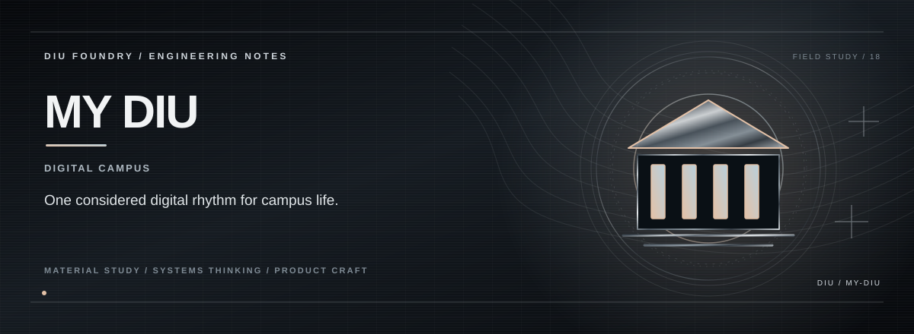

> **DIGITAL CAMPUS.**

## THE PREMISE

My DIU explores what a university digital layer could feel like when campus information, student workflows and everyday services are designed as one experience.

## THE EXPERIENCE

**One campus, one digital rhythm.**  
**Put utility within reach.**  
**Make student workflows feel intentional.**

## THE SYSTEM

A Next.js application foundation provides the shell for reusable campus components and future university-service integrations.

## THE STACK

Next.js · React · TypeScript · Tailwind CSS

## RUN

```bash
npm install
npm run dev
```

## PROJECT STATE

**Digital-campus product concept**

Implemented behaviour is documented separately from future integrations so the project story stays honest as the product evolves.

---

<p align="center"><strong>K. KISHOR KUMAR</strong><br><sub>ENGINEERING / PRODUCT / SYSTEMS</sub></p>
